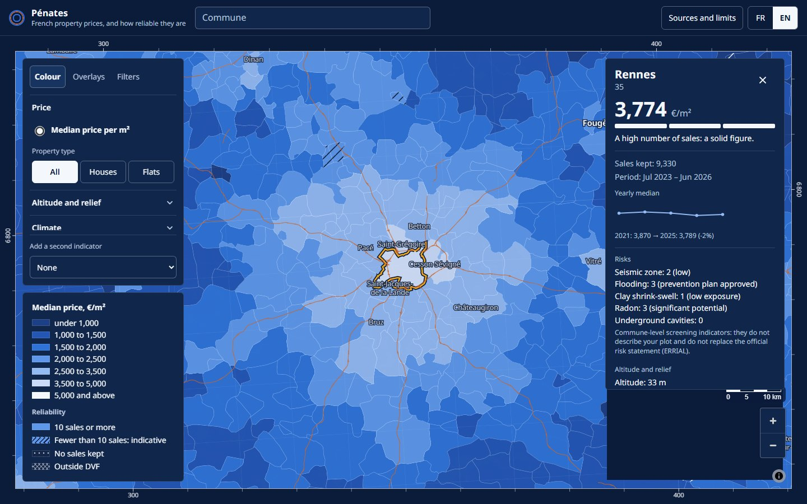
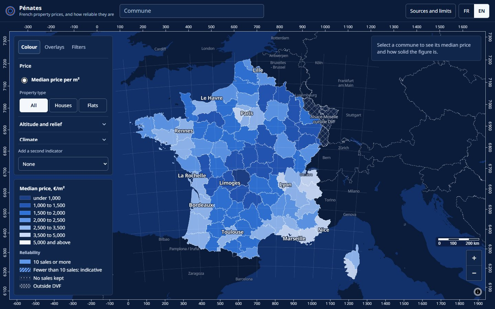
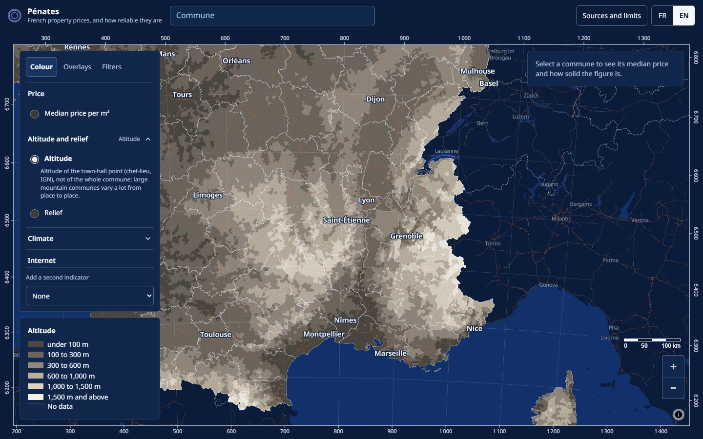
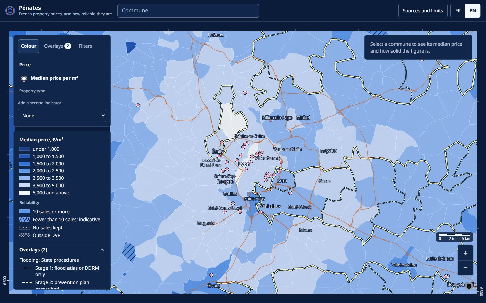
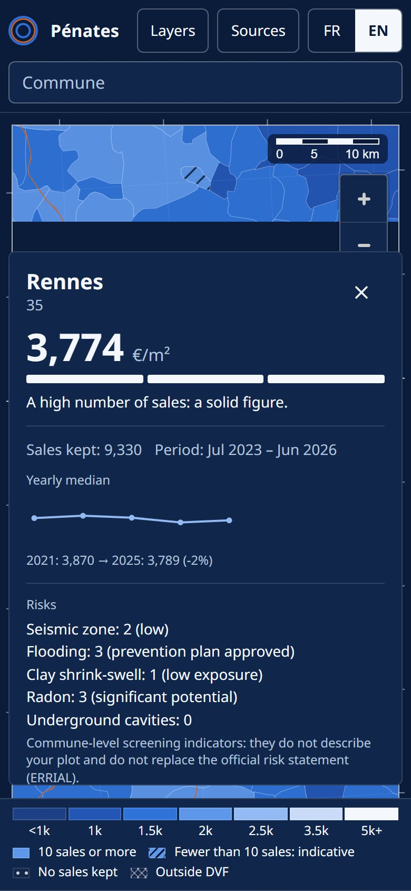

<p align="center">
  
</p>

<h1 align="center">Pénates</h1>

<p align="center"><strong>An interactive map of France to help you choose where to buy a home, built only from open data.</strong><br>
<em>Une carte interactive de la France pour choisir où acheter, à partir de données ouvertes.</em></p>

<p align="center">
  <a href="https://github.com/LightSeek3r/penates/actions/workflows/ci.yml"></a>
  <a href="LICENSE"></a>
  <a href="docs/data-licences.md"></a>
  <a href="https://github.com/LightSeek3r/penates/releases/latest"></a>
  
  
</p>

<p align="center">
  <a href="https://penates.unit42.fr"><strong>Open the map</strong></a> ·
  <a href="docs/methodology.md">Methodology</a> ·
  <a href="docs/data-licences.md">Data and licences</a> ·
  <a href="CHANGELOG.md">Changelog</a> ·
  <a href="https://github.com/LightSeek3r/penates/issues">Report an issue</a>
</p>

<p align="center">
  
</p>

Pénates colours metropolitan France by the **median sale price per m²**, by département and then by
commune, and puts risks, relief, climate, fibre and everyday services on top. Every figure says how many
sales stand behind it, and what is missing is drawn as missing, never as "safe". It is free, needs no
account and sets no cookies.

**En bref.** Pénates colore la France métropolitaine selon le prix médian au m² (par département puis par
commune) et y superpose risques, relief, climat, fibre et services. Chaque chiffre indique le nombre de
ventes qui le fondent, et une donnée absente est montrée comme absente, jamais comme « sans risque ».
Gratuit, sans compte, sans cookie. Méthode : [docs/methodology.fr.md](docs/methodology.fr.md).

**Part of [Unit42](https://unit42.fr).** Built and maintained by [LightSeek3r](https://github.com/LightSeek3r).
This README is for people who want to run, read or contribute to the code; the map itself is at
<https://penates.unit42.fr>.

- [What it shows](#what-it-shows)
- [Principles](#principles)
- [Screenshots](#screenshots)
- [Repository layout](#repository-layout)
- [Getting started](#getting-started)
- [Data pipeline](#data-pipeline) · [Testing](#testing) · [Deployment](#deployment)
- [Versioning](#versioning) · [Privacy](#privacy)
- [Contributing](#contributing) · [Licences and credits](#licences-and-credits)

## What it shows

- **Price per m²** from the DGFiP "Demandes de valeurs foncières" (DVF): the median of the last 36 months
  (60 when a commune has too few sales), for all dwellings, houses or flats, with the sales count, the
  period, yearly medians and a reliability class drawn as a texture (solid, indicative, none).
- **Risks:** seismic zone, flooding, clay shrink-swell, radon and underground cavities, as filters, in the
  details panel and as zone lines on the map. They are screening indicators and do not replace the legal
  *état des risques* (ERRIAL).
- **Altitude and relief**, **climate** (sunshine and projected hot days), **distances to services**
  (hospitals, GPs, schools, shops, stations...), **fibre**, **indicative rent and land-tax rate**, and
  **recorded crime** only on request.
- **Overlays:** risks as lines and places (hospitals, schools, shops, stations, pools...) as dots over the
  colour theme.
- **Filters** that combine indicators, and a **second indicator** drawn with the first (crossed colours or
  sized discs). Everything is carried by the link, so a view can be shared.
- French and English, installable as a PWA, keyboard operable, colour-blind-safe palettes, WCAG AA target.

The full definitions, sources and limits are in [docs/methodology.md](docs/methodology.md).

## Principles

1. **Show uncertainty, not false precision.** Every number carries its sample size, date and limits.
2. **Absence of data is not safety.** Gaps are shown as gaps; Alsace-Moselle and Mayotte, absent from DVF,
   are hatched and labelled "Outside DVF".
3. **Aggregates only.** No individual sale, address or person appears in the tiles, the repository or any
   page, as the DVF terms of use require.
4. **Open by default.** Code, methods, sources and licences are inspectable.
5. **Sensitive layers are opt-in** and carefully worded (recorded crime in particular).

## Screenshots

<table>
  <tr>
    <td width="50%"></td>
    <td width="50%"></td>
  </tr>
  <tr>
    <td width="50%"></td>
    <td width="50%" align="center"></td>
  </tr>
</table>

## Repository layout

```
app/        React + TypeScript + Vite front end (MapLibre GL, PMTiles) and Cloudflare Pages Functions
  src/        the app: map, layer catalogue, themes, filters, overlays, i18n (fr/en), PWA
  functions/  /api/event and /api/admin (anonymous daily counters, behind Cloudflare Access)
  e2e/        Playwright tests, run against the production build
pipeline/   Python data build that turns open data into PMTiles (see pipeline/README.md)
docs/       methodology, data licences and legal notice, in English and French
.github/    CI, data builds, deploy, smoke, Lighthouse and production e2e workflows
DESIGN.md · PRODUCT.md · .impeccable/ · .claude/plans/   design contract, product brief and the plans
```

## Getting started

You need Node 24 with [pnpm](https://pnpm.io) for the app. The map reads vector tiles from a data host;
either use the public one or build your own (see [Data pipeline](#data-pipeline)).

```bash
cd app
pnpm install

# Against the public tiles:
VITE_DATA_BASE=https://settling-tiles.unit42.fr pnpm dev      # http://localhost:5173

# Or against tiles you built (default data host is http://localhost:8788):
pnpm serve-data ../data/build/national 8788 &
pnpm dev
```

| Script | What it does |
| --- | --- |
| `pnpm dev` | Vite dev server |
| `pnpm build` | Typecheck and production build, including the service worker |
| `pnpm lint` | oxlint |
| `pnpm typecheck` | `tsc -b` |
| `pnpm test` | Unit tests (Vitest) |
| `pnpm e2e` | Playwright against the production build behind the Pages runtime (`wrangler pages dev`) |

## Data pipeline

`pipeline/` is pure Python (DuckDB, shapely, mapbox-vector-tile, pmtiles: no tippecanoe, no GDAL). It
downloads the open sources, cleans and aggregates them, and writes the tile archives and a manifest.

```bash
python -m venv pipeline/.venv
pipeline/.venv/bin/python -m pip install -r pipeline/requirements.txt
pipeline/.venv/bin/python -m pip install -e pipeline
pipeline/.venv/bin/python -m settling.build --dep 69 --out data/build/slice     # one département
pipeline/.venv/bin/python -m settling.build --out data/build/national           # metropolitan France + Corsica
pipeline/.venv/bin/python -m pytest pipeline/tests -q
```

(On Windows the interpreter is `pipeline/.venv/Scripts/python`.) The build is idempotent, retries dropped
connections, and a plausibility gate blocks publishing bad data. Options and outputs are in
[pipeline/README.md](pipeline/README.md). The Python package is still called `settling`, the project's
former working name.

## Testing

```bash
cd app
pnpm test        # 347 unit tests
pnpm e2e         # DATA_PORT and APP_PORT move the servers when the defaults are taken
cd ..
python -m pytest pipeline/tests -q
```

CI runs lint, typecheck, unit tests and the build for the app, and pytest for the pipeline.

## Deployment

The app is a static PWA plus a few Pages Functions, deployed to **Cloudflare Pages** at
<https://penates.unit42.fr>; tiles and data live on **Cloudflare R2** (`settling-tiles.unit42.fr`), which
keeps data files out of git. The workflows in `.github/workflows/` are the reference:

| Workflow | Trigger | What it does |
| --- | --- | --- |
| CI | push, PR | lint, typecheck, tests and build (app); pytest (pipeline) |
| Build data | manual, 15 April and 15 October | builds the national tiles, runs the plausibility gate, publishes to R2 |
| Build overlays | manual, 1 May and 1 November | builds the overlay archive from the BPE, Géorisques and the live communes |
| Deploy app | manual | builds the app and deploys it with Wrangler |
| Smoke, Production e2e, Lighthouse | manual | checks against a deployed site |

Publishing needs these repository secrets: `CLOUDFLARE_ACCOUNT_ID`, `CLOUDFLARE_API_TOKEN`,
`R2_ACCESS_KEY_ID` and `R2_SECRET_ACCESS_KEY`. Without them the deploy and data workflows fail; forks
can ignore them.

## Versioning

[Semantic Versioning](https://semver.org), loosely while the project is 0.x. Each release is a `vX.Y.Z` tag
with a [GitHub release](https://github.com/LightSeek3r/penates/releases) whose notes come from
[CHANGELOG.md](CHANGELOG.md); the running version is shown at the bottom of the "Sources and limits"
dialog. To cut a release: move the `Unreleased` entries under a new version heading, bump `version` in
`app/package.json`, commit, and push the `v*` tag: the release workflow publishes it.

## Privacy

No account, no cookie, no advertising, no individual tracking. The only measurement is anonymous daily
counters (page and feature totals, no IP address, no typed text), which a switch in the app turns off. The
details are in the [legal notice](docs/legal.md).

## Contributing

Issues and pull requests are welcome; see [CONTRIBUTING.md](CONTRIBUTING.md) and the
[Code of Conduct](CODE_OF_CONDUCT.md). Security problems go through [SECURITY.md](SECURITY.md).

## Licences and credits

Code: [MIT](LICENSE) © 2026 LightSeek3r. **Data keeps the licence of each source** (Licence Ouverte v2.0 for
most of it, ODbL for OpenStreetMap), with the credits to display listed in
[docs/data-licences.md](docs/data-licences.md); see also [NOTICE](NOTICE).
